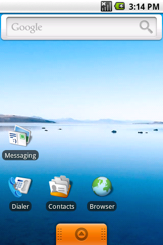

# Android 1.6 (Donut) ARM Emulator on Modern Android

Port of the classic **Android 1.6 (Donut) ARM Goldfish** virtual platform onto modern **QEMU 11.1.3** (`arm-softmmu` + `aarch64` TCG JIT), packaged as a standalone modern Android app with live shared storage for installing & moving `.apk` files.



## Architecture

- **Guest OS:** Official Android 1.6 (`android-1.6_r03`, API 4) ARM Goldfish SDK images (`kernel-qemu`, `ramdisk.img`, `system.img`, `userdata.img`) — supports both pure-Java and `armeabi` native NDK `.apk`s.
- **Virtual Hardware (`goldfish/hw/arm/goldfish/`):** Clean modern QEMU 11 port of the Goldfish ARM926EJ-S board (`-M goldfish`, `board_id=1441`):
  - `goldfish_pic` (32-IRQ interrupt controller) + `goldfish_pdev_bus` (platform device bus)
  - `goldfish_timer` + `goldfish_rtc`
  - `goldfish_tty` (serial console)
  - `goldfish_nand` (MTD YAFFS2 flash with 2048+64 B OOB for `system`, `userdata`, `cache`)
  - `goldfish_fb` (320×480 RGB565 → QEMU `DisplaySurface`/VNC with non-stalling 16 ms frame completion)
  - `goldfish_events` (`qwerty` keypad + 1:1 absolute touchscreen)
  - `goldfish_mmc` (SD card controller mounting a FAT32 `sdcard.img` at `/sdcard`)
  - `goldfish-battery` + `goldfish_memlog` + upstream `smc91c111` Ethernet (`eth0 10.0.2.15`, stock `adbd` listening on TCP `5555`)

## Project Roadmap

- [x] **Phase 1:** Fetch official Android 1.6 ARM SDK images & upstream QEMU 11.1.3
- [x] **Phase 2:** Port Goldfish board into QEMU 11.1.3 & boot Android 1.6 to portrait Home screen on macOS (`arm64`)
- [ ] **Phase 3:** Cross-compile lean Goldfish-only `qemu-system-arm` for Android `arm64-v8a` (NDK 27)
- [ ] **Phase 4:** Build Android Kotlin host app (`SurfaceView` VNC client, Donut hardware nav bar, shared-storage folder & live APK installer via ADB/HTTP)

## Building & Running on macOS (Phase 2)

1. Download upstream QEMU 11.1.3 and Android 1.6 SDK images:
   ```bash
   curl -fSL -o qemu-11.1.3.tar.xz https://download.qemu.org/qemu-11.1.3.tar.xz
   tar -xf qemu-11.1.3.tar.xz

   mkdir -p images
   curl -fSL -o images/android-1.6_r03-linux.zip https://dl.google.com/android/repository/android-1.6_r03-linux.zip
   unzip -j images/android-1.6_r03-linux.zip "android-1.6_r03-linux/images/*" -d images/
   mksdcard -l SDCARD 64M images/sdcard.img
   ```
2. Overlay the Goldfish board onto QEMU 11.1.3:
   ```bash
   ./scripts/apply-goldfish.sh ./qemu-11.1.3
   ```
3. Configure and build `qemu-system-arm`:
   ```bash
   brew install meson ninja libslirp dtc glib pixman
   mkdir -p build-mac && cd build-mac
   ../qemu-11.1.3/configure --target-list=arm-softmmu --enable-fdt=system --enable-tcg --enable-vnc --enable-slirp --enable-cocoa
   ninja qemu-system-arm
   ```
4. Boot Android 1.6:
   ```bash
   ./scripts/run-mac.sh
   ```
   - Press **F1** to unlock the lock screen (Menu key).
   - **Esc** or right-click = Back, **Home** = Home, click/drag = touchscreen.
   - Connect via ADB while running: `adb connect 127.0.0.1:5555`.
